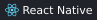
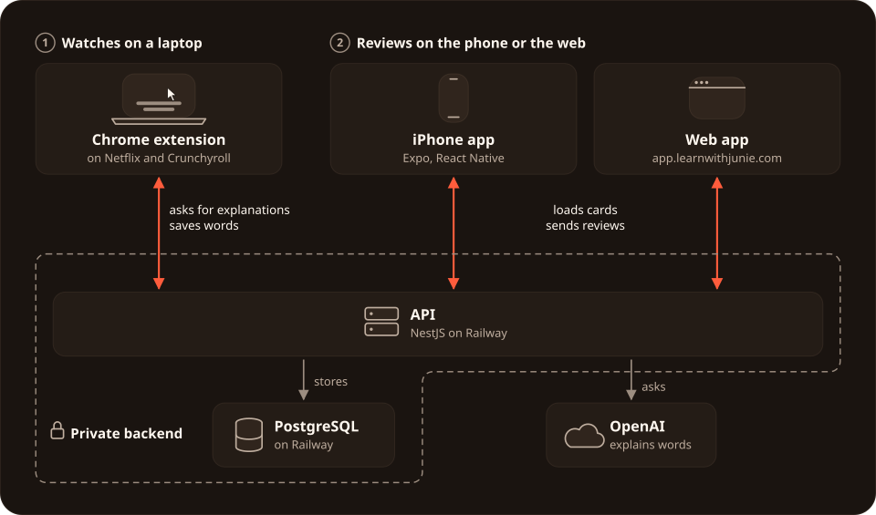
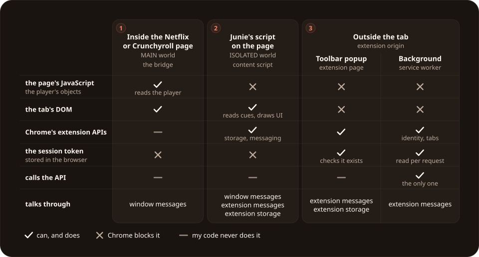
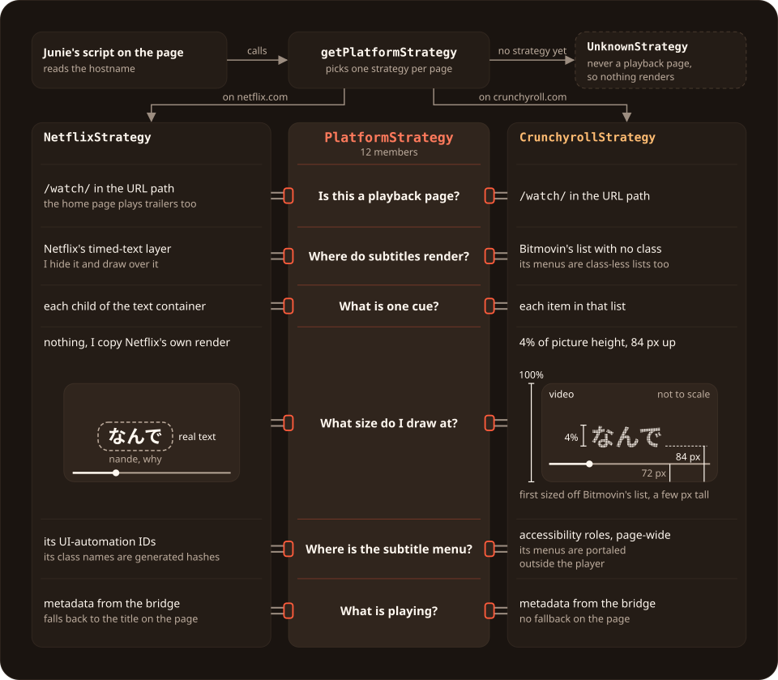
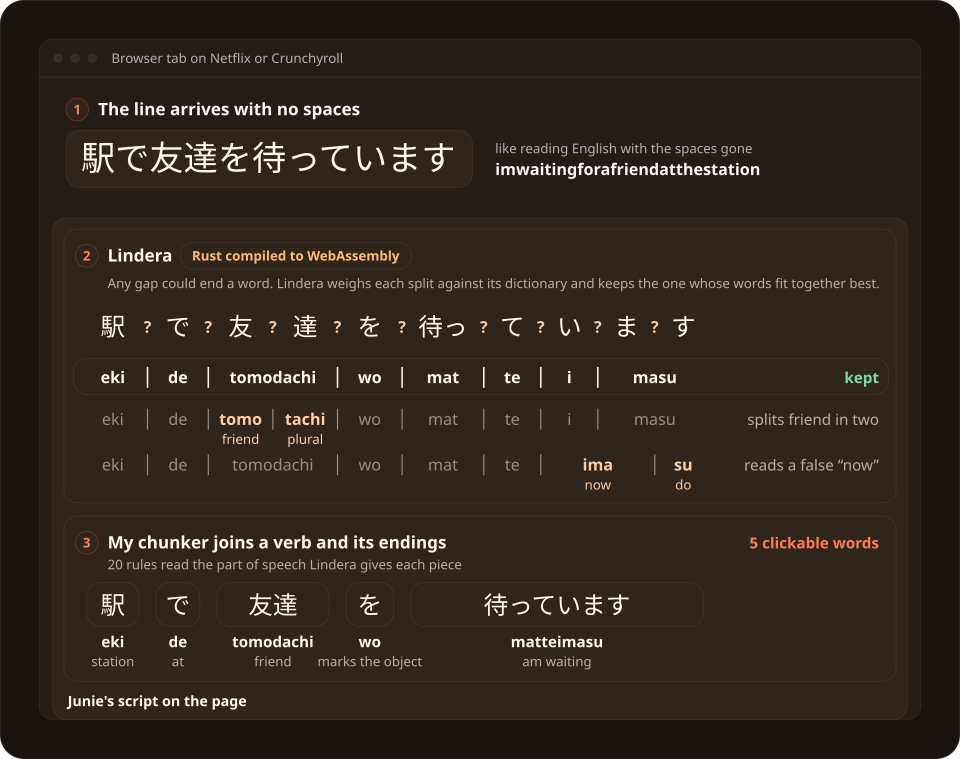
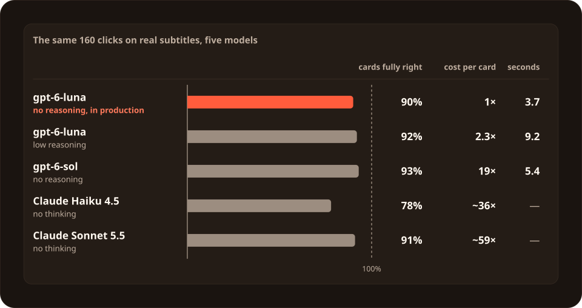
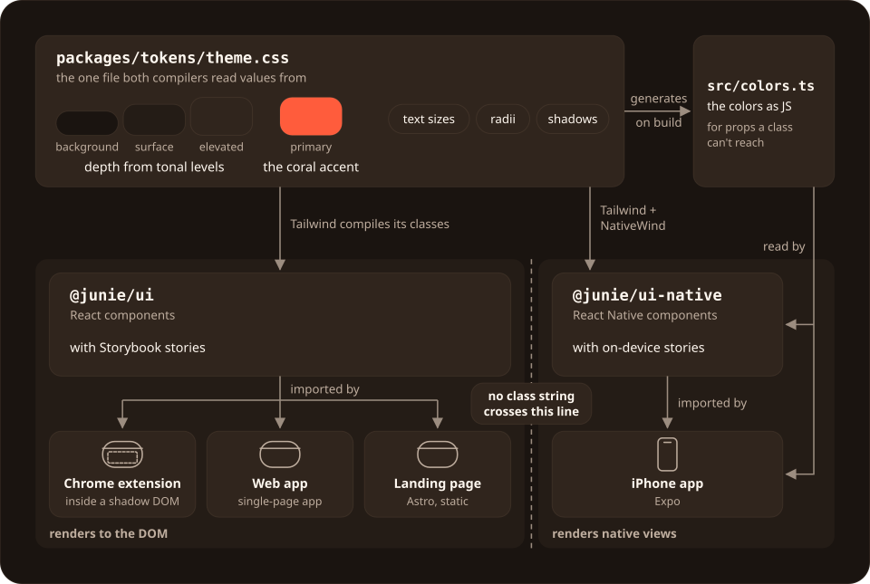
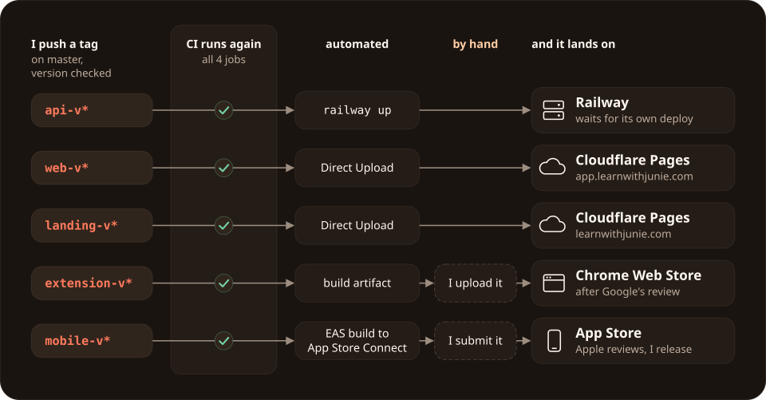
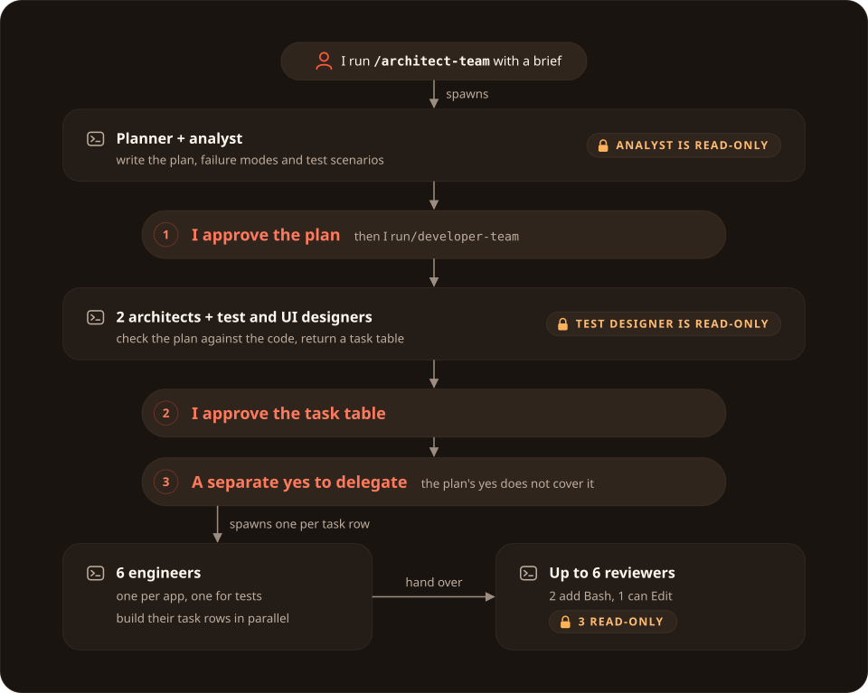

# Junie

**Click any word in the Japanese subtitles on Netflix or Crunchyroll and get it explained in the context of its scene. Saved words come back as flashcards on iPhone and the web.**

  
  

**[Chrome Web Store](https://chromewebstore.google.com/detail/cdaobgmpfjeldafknpbidbkdiinniaak)** · **[App Store](https://apps.apple.com/app/id6825073463)** · **[learnwithjunie.com](https://learnwithjunie.com)**

  
  
  
  
  
  
  
  
  
  
  
  
  

I built Junie alone, and this repo shows how, mostly in diagrams. It's a snapshot of Junie as of November 2026. The code is private, so nothing here builds or runs. It leaves out the backend code, the AI prompts, how sign-in works and where the subtitles come from.

**[How Junie is built](#how-junie-is-built)** [overview](#click-on-the-laptop-review-on-the-phone) · [extension](#living-inside-someone-elses-page) · [streaming sites](#every-player-is-different-the-subtitle-code-doesnt-care) · [tokenizer](#where-does-a-word-end-when-there-are-no-spaces) · [model choice](#the-cheapest-model-kept-up-with-sonnet) · [design system](#change-a-colour-once-every-app-follows) · [shipping](#from-git-tag-to-app-store) · [testing](#a-test-that-mocks-everything-tests-nothing)  
**[How I work with AI](#how-i-work-with-ai)** [agents and gates](#big-changes-wait-for-three-yeses) · [rules](#written-linted-hooked)

## How Junie is built

### Click on the laptop, review on the phone

*The three apps only talk to the API, and only the API writes to PostgreSQL or calls OpenAI.*

You watch on a laptop and review on a phone, so one account has to follow you across the Chrome extension, the iPhone app and the web app. You sign in with Google or Apple, and how sign-in works beyond that is a *security secret*.

Full stack

<table>
<thead><tr><th>Part</th><th>Built with</th></tr></thead>
<tbody>
<tr><td>Chrome extension</td><td>TypeScript, React, Rsbuild, Tailwind CSS, TanStack Query and Store, lindera-wasm-web</td></tr>
<tr><td>iPhone app</td><td>Expo, React Native, Expo Router, NativeWind, TanStack Query, DB and Store</td></tr>
<tr><td>Web app</td><td>React, TanStack Router, Query, DB and Store, Rsbuild, Tailwind CSS</td></tr>
<tr><td>Landing page</td><td>Astro with React islands, Tailwind CSS</td></tr>
<tr><td>API</td><td>TypeScript, NestJS, nestjs-zod, Zod, Drizzle, PostgreSQL, OpenAI SDK</td></tr>
<tr><td>Monorepo and tests</td><td>Node.js, pnpm, Turborepo, Rstest, jest-expo, Rslint, Storybook</td></tr>
<tr><td>Running it</td><td>Railway for the API and its database, Cloudflare Pages for the web app and landing page, Paddle for billing</td></tr>
</tbody>
</table>

### Living inside someone else's page

*Only the bridge touches the page's JavaScript, and only the background worker talks to the API.*

*Step 1 passes the player's metadata, steps 2 to 5 run for every subtitle line, and steps 6 and 7 only on a click.*

Junie's extension is four programs, and Chrome decides where each one runs and what it can touch. Each one exists because no other part can do its job.

- **The bridge** runs in the page's own JavaScript world, which Chrome calls the MAIN world. The player's state only exists there, so it's the only part that can ask the player what's playing. It uses no extension APIs, and the page can see everything it does.
- **Junie's script** runs in the same tab, but in Chrome's ISOLATED world. It shares the page's DOM, so it can read each subtitle line, run Lindera on it and draw clickable words over the player. It can't see the page's variables, so it only knows what the bridge tells it.
- **The toolbar popup** is an extension page outside the tab. It holds settings and sign-in, and it can't touch the tab at all.
- **The background service worker** runs at the extension's own origin. A request from the tab would go out as the streaming site, so every API call travels to the worker as an extension message and leaves from there.

The four can't share a single variable. They talk through window messages inside the tab, extension messages between the tab and the extension, and extension storage for settings. That's the price. Every feature that crosses a boundary needs a message, and every message gets checked when it arrives. The bridge's messages need the most care, because the page can read and forge them, and an old bridge stays in the page after the extension reloads and keeps talking.

### Every player is different, the subtitle code doesn't care

*The same six questions, answered from two very different pages.*

Netflix and Crunchyroll show the same thing, a video with a line of subtitles, but their pages have almost nothing in common. Netflix renders subtitles in its own timed-text layer. Crunchyroll's player is built on Bitmovin and draws them as a plain list with no class names. Netflix's menu classes are generated hashes, so Junie finds the menu by its UI-automation IDs instead. Crunchyroll's menus aren't even inside the player.

So each site gets one strategy class that answers the same 12 questions, such as whether this is a playback page or where one subtitle line starts and ends. Junie's script picks the strategy from the hostname. From then on, the code that finds the subtitles, hides the site's own and draws Junie's clickable copy only asks the strategy. There's no "if Netflix" anywhere in it. Adding a third site means one new class and one value in the `Platform` enum, and the manifest generates its host permissions and content-script matches from that enum.

The catch is that the interface has to fit every site at once. When Crunchyroll needed two questions about subtitle size, Netflix had to answer them too, with `null`.

### Where does a word end when there are no spaces?

*Real output from the released extension's Lindera 5.3 and chunker, on a line I wrote and glossed, with two splits Lindera turned down.*

Japanese doesn't put spaces between words, so a subtitle line arrives as one unbroken string. Before anyone can click a word, something has to decide where each word ends, for every line, while the show is playing.

That something is Lindera, a Rust morphological analyzer compiled to WebAssembly. It runs inside the tab with its dictionary bundled in the extension, so splitting a line never touches the network. But Lindera returns dictionary pieces, not the words a learner thinks in, so my chunker joins the pieces back into words worth clicking.

That's where Japanese gets hard, because the same piece does different jobs in different places. 学生だった (gakusei datta, "was a student") and 静かだった (shizuka datta, "was quiet") end the same way, but they split differently. After a noun, だった is the verb "to be", so it becomes its own word. After 静か it's how the adjective conjugates, so it stays on the adjective. In 読んだ (yonda, "read") the same だ is the past tense, so it stays on the verb. Polite speech breaks simple rules too. A rule that kept a noun apart from the verb after it split お待ちしております (omachi shite orimasu, "I'll be waiting", humble), which is built exactly that way, so that rule is now banned. And anime speech stretches words, like すげー (sugē, "awesome"), where the stretch has to stay on the word.

The dictionary is the weak spot. Lindera only knows the words in it, so I add character names and slang myself, and the rebuilt dictionary is tied to the exact Lindera version I pin. And when a split is wrong, no model can fix it, because the AI is shown the boundaries and never moves them.

### The cheapest model kept up with Sonnet

*Fully right means an Opus judge passed every field of the card. Clicks the word splitter cut differently are left out, since they affect all five models alike. Claude costs are estimates.*

Every click asks a model to explain a word in the context of its scene, so the model is the product, and I pay for it on every click. I didn't want to choose it by gut feeling, so I built an eval. A simulated beginner pauses real Netflix episodes at random moments and clicks a random word. Each click goes through the extension's real tokenizer and the exact request the API builds, and an Opus judge checks every field of every card.

gpt-6-luna with no reasoning kept up with Claude Sonnet 5.5 at a small fraction of the cost, and it answers in under four seconds on average.

Getting a small model there was the hard part. Ideas that sound obviously helpful made the cards worse when judged blind. Giving the model a dictionary entry for the word made its cards more misleading. More English context around the line did worse, not better. Anime speech was its own fight. The model has to warn a learner that a word like お前 (omae, a rough "you") sounds harsh outside a show, without stamping a warning on every everyday word. What did help was measured the same way. Handing the model Lindera's reading of the line roughly halved its grammar mistakes.

### Change a colour once, every app follows

*The tokens feed a React library for the three browser surfaces and a React Native library for the iPhone app.*

Junie has four surfaces. Three render to the DOM and the iPhone app renders native views, and all four have to look like one product. So the colours, text sizes, radii and shadows live in one file, theme.css. Tailwind compiles it into the classes the extension, the web app and the landing page use. NativeWind turns the same file into native styles on the iPhone, and a build step writes the colours out as plain JavaScript for the few native props a class can't reach. Change a colour in that file, and every app picks it up on its next build.

The two worlds share values, but not much else. React Native can't parse `color-mix()` or the `rgb(… / …)` syntax, so every colour in the file is a plain literal. A computed one would render perfectly on the web and break the iPhone app at runtime. Some classes don't make the trip either. An inset shadow that works in the browser does nothing on the iPhone, so the native library draws it another way. That's why web and native never share a class string, and every component both apps need is written twice, once in React and once in React Native.

### From git tag to App Store

*Each tag runs CI again on its own commit and ships only its piece. Both stores also need a step by hand and a review.*

Junie is five pieces, and each one ships on its own git tag, like `api-v…` or `mobile-v…`. Nothing else reaches production. A tag runs CI again on its own commit and ships only that piece, to Railway, Cloudflare Pages or one of the two stores, where I still send the build in by hand and wait for review. Because the pieces never ship together, every API release has to keep working with the apps people already have.

### A test that mocks everything tests nothing

*In every row, the replaced parts sit past the edge of the app and stand in for the API or for Chrome.*

A test that replaces everything around its code only tests the replacements. It stays green while the real code breaks. So I test in the classical style. My own code and the libraries it uses run for real, Lindera's WASM and dictionary included, and a test only gets a stand-in where it would leave the app. That means the API client that talks to my server, the browser and phone platform APIs, the clock and randomness. The web and iPhone integration tests render the whole app at a URL, with its real routes, screens and query cache. A test also has to earn its place. I write one only when a failure would be silent, when the behaviour is load-bearing, or when it broke before.

The extension was the hardest part to test.

- No test can reach a real Netflix or Crunchyroll player, so the tests use fake ones. A value taken from the live site is marked as measured, and a made-up one says so.
- Chrome's extension APIs don't exist in the test runner, so a stub stands in for storage and messaging. It has to load before any test code, because a setting read too early falls back to its default and the test passes on the wrong value.
- One component test passed while every subtitle line failed inside it. Lindera's WASM couldn't start in the fake browser the tests run in, and the error was swallowed. Now a component test may swap in a stand-in tokenizer, but only where the words aren't what's under test.

## How I work with AI

### Big changes wait for three yeses

*Changes to a route, a screen, a shared package export or an API contract take this whole path, and an everyday fix skips it.*

Most changes are everyday fixes. An agent researches, makes the change and checks it, and that's it. A change to a route, a screen, a shared package or the API contract goes the long way, and it stops three times for me.

First, a planner agent researches the code, runs a pre-mortem, and gets a list of failure modes and test scenarios from a QA agent. It writes a plan with every open decision laid out as options with a recommendation, and nothing moves until I pick. Then an architect turns the plan into a table of tasks listing the files each engineer will change, so I see the scope before any code exists. Then I give a separate yes to hand the work off at all, because approving a plan isn't approving the handoff. When the engineers finish, reviewer agents check the work, and several of them can only read the code, not change it.

The rules say that at a gate, waiting is the correct action, and that my frustration counts as emphasis, never as approval. No hook enforces any of this. The gates hold only while the agents follow the written rules.

The 20 agents and what each may touch

<table>
<thead><tr><th>Agent</th><th>Tools</th><th>Role</th></tr></thead>
<tbody>
<tr><td><code>feature-planner</code></td><td>Read, Grep, Glob, Write, Agent</td><td>Frames a feature from a brief and writes the two-part plan</td></tr>
<tr><td><code>qa-analyst</code></td><td>Read, Grep, Glob</td><td>Finds failure modes, writes the done-check and test scenarios</td></tr>
<tr><td><code>frontend-architect</code></td><td>Read, Grep, Glob, Bash, Write, Agent</td><td>Specs frontend work across extension, web and mobile</td></tr>
<tr><td><code>backend-architect</code></td><td>Read, Grep, Glob, Bash, Write, Agent</td><td>Specs backend work and the shared contracts</td></tr>
<tr><td><code>qa-architect</code></td><td>Read, Grep, Glob</td><td>Turns approved scenarios into a test design</td></tr>
<tr><td><code>ux-ui-designer</code></td><td>all</td><td>Specs layouts and guards the design system</td></tr>
<tr><td><code>extension-engineer</code></td><td>all</td><td>Implements the Chrome extension</td></tr>
<tr><td><code>web-engineer</code></td><td>all</td><td>Implements the web app</td></tr>
<tr><td><code>mobile-engineer</code></td><td>all</td><td>Implements the Expo mobile app</td></tr>
<tr><td><code>landing-page-engineer</code></td><td>all</td><td>Implements the Astro landing page</td></tr>
<tr><td><code>backend-engineer</code></td><td>all</td><td>Implements the NestJS backend</td></tr>
<tr><td><code>qa-engineer</code></td><td>all</td><td>Writes the test files from the test design</td></tr>
<tr><td><code>code-reviewer</code></td><td>Read, Grep, Glob, Bash</td><td>Reports only bugs and rule breaks it can prove</td></tr>
<tr><td><code>silent-failure-hunter</code></td><td>Read, Grep, Glob, Bash</td><td>Hunts swallowed errors and dangerous fallbacks</td></tr>
<tr><td><code>type-design-analyzer</code></td><td>Read, Grep, Glob</td><td>Checks that types make illegal states unrepresentable</td></tr>
<tr><td><code>use-effect-reviewer</code></td><td>Read, Grep, Glob</td><td>Flags unneeded or wrong <code>useEffect</code></td></tr>
<tr><td><code>code-simplifier</code></td><td>Read, Edit, Grep, Glob, Bash</td><td>Simplifies changed code without changing behavior</td></tr>
<tr><td><code>build-error-resolver</code></td><td>Read, Write, Edit, Bash, Grep, Glob</td><td>Fixes a red build with the smallest diff</td></tr>
<tr><td><code>refactor-cleaner</code></td><td>Read, Write, Edit, Bash, Grep, Glob</td><td>Removes dead and duplicate code</td></tr>
<tr><td><code>reel-critic</code></td><td>Read, Grep, Glob, Bash</td><td>Predicts how a short video will do before it is posted</td></tr>
</tbody>
</table>

There are also 9 skills. <code>architect-team</code> runs the path up to my first yes, and <code>developer-team</code> runs the rest. Counted on 15 November 2026.

### Written, linted, hooked

*The three places a rule can live, and the two hooks the lint runs in.*

A rule in CLAUDE.md is guidance, and nothing makes an agent follow it. So each rule lives in one of three places, depending on how far it can be enforced.

Most rules are only written down. CLAUDE.md files say how the code is written, and REQUIREMENTS.md files say what a user sees the app do. Both hold rules only, one per line, with no reasons attached. A few rules that a linter can check become custom lint rules, and that's where the reason lives, in the error message itself. An agent that trips a rule can usually silence it without fixing anything, by splitting a long comment in two or swapping one abbreviation for another. So every message names that dodge and forbids it.

Then hooks run the lint. Every file an agent writes is linted on the spot, and the findings go straight back to the agent. Before a commit, a fresh Claude reads the code and doc changes for anything false they add. That check fails open. If the checker can't run, the commit goes through with a warning, because a broken checker shouldn't block the work.

## Talk to me

I'm happy to walk through any of this, private code included, on a screen-share call. [LinkedIn](https://linkedin.com/in/vit-vintrlik)

© 2026 Vít Vintrlik. All rights reserved. The diagrams and text are here for review only. No licence is granted to copy, modify or redistribute them.
